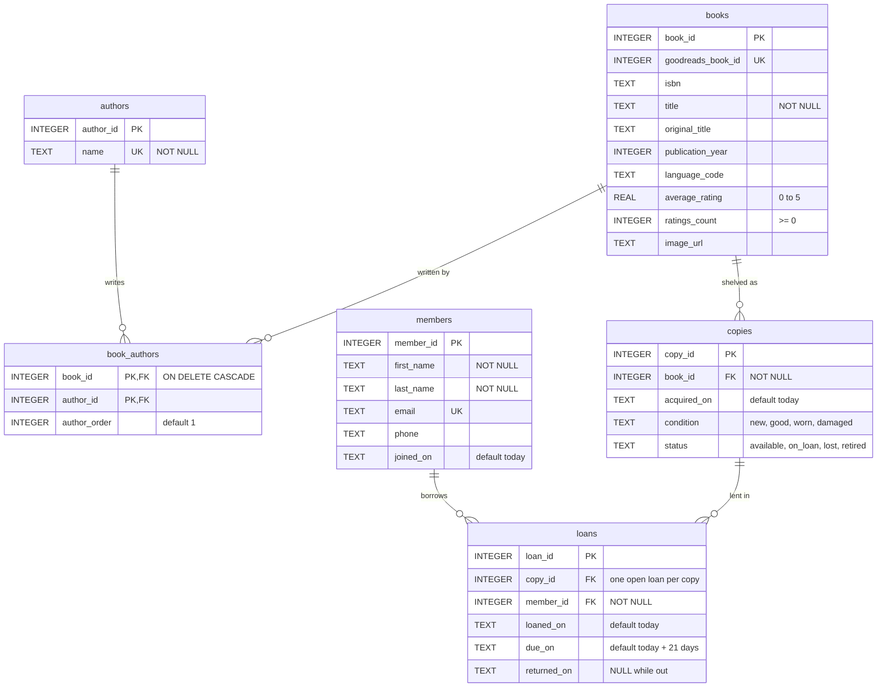
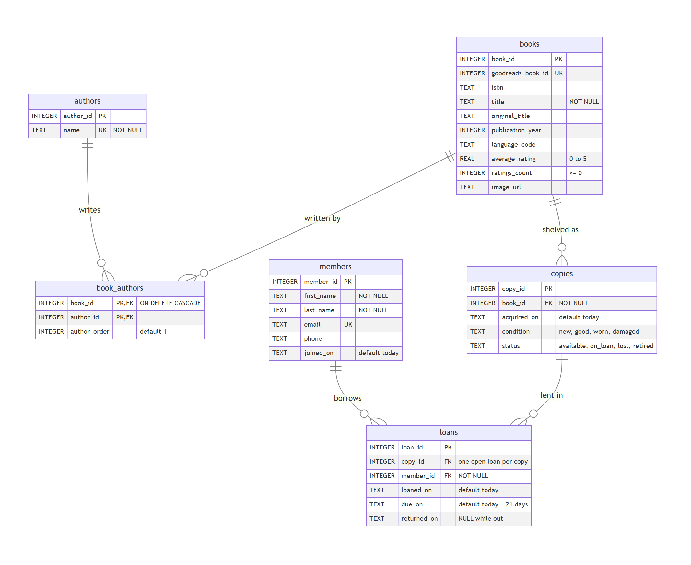

# library.db Summary

## Entity-Relationship Diagram

PNG version ([erd.png](erd.png)):

## Tables

| Table | Purpose | Rows |
|---|---|---|
| `books` | Catalog of titles, loaded from goodbooks-10k `books.csv` | 10,000 |
| `authors` | One row per author | 5,841 |
| `book_authors` | Links books to their authors (many-to-many) | 13,209 |
| `members` | Library patrons (made-up sample data) | 6 |
| `copies` | Physical copies on the shelves | 10 |
| `loans` | Borrowing history and open loans | 13 |

## Relationships

- A **book** has one or more **authors**, and an author can write many books, linked through `book_authors`.
- A **book** can have many physical **copies**; each copy belongs to exactly one book.
- A **member** can have many **loans**, and a **copy** can be lent many times, but only one open loan per copy at a time (`idx_loans_one_open_per_copy`).

## Files

- `schema.sql` creates the tables and indexes.
- `load_books.sql` imports `books.csv` into `books`, `authors` and `book_authors`.
- `seed_data.sql` adds the sample members, copies and loans.
- `erd.mmd` is the Mermaid source for the diagram above.
