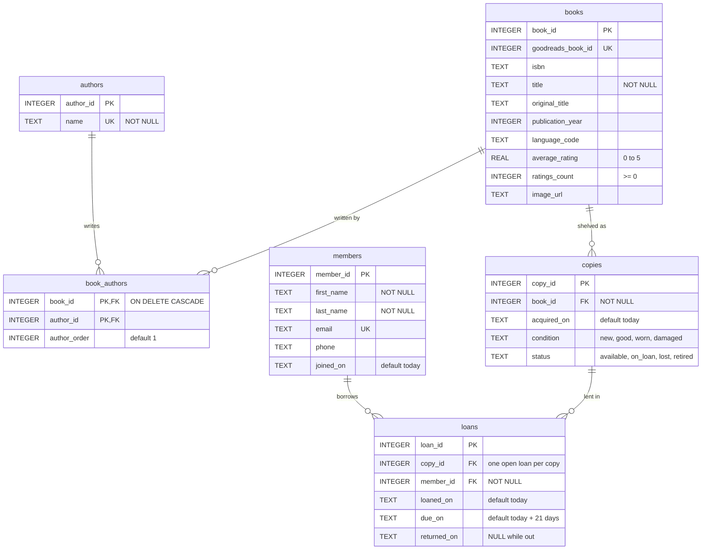

# library.db Summary

## Entity-Relationship Diagram

PNG version ([erd.png](erd.png)):

## Summary

### What each table represents

`library.db` models a small lending library with six tables. **`books`** is the catalog: one row per title, with its ISBN, publication year, language and Goodreads rating. I loaded all 10,000 titles from the goodbooks-10k dataset, so it describes every book the library *could* own, not what is on the shelf. **`authors`** stores each author's name exactly once, so "J.K. Rowling" is not repeated across every Harry Potter row. **`book_authors`** connects the two and exists only because a book can have more than one author. **`members`** holds the people who hold a library card. **`copies`** represents the physical books on the shelves, each with its own condition and status. **`loans`** records every borrowing: which copy, which member, when it went out, when it is due, and when it came back.

### One-to-many and many-to-many relationships

There are three one-to-many relationships. One book can have many copies (`copies.book_id`), one copy can be lent many times over its life (`loans.copy_id`), and one member can borrow many times (`loans.member_id`). In each case the "many" side stores a foreign key pointing back to the "one" side's primary key, and SQLite refuses a copy or loan that points at a row that doesn't exist (as long as `PRAGMA foreign_keys = ON` is set).

The many-to-many relationship is between books and authors: *1984* has several contributors listed, and George Orwell wrote both *1984* and *Animal Farm*. A single column can't hold that, so `book_authors` stores one row per (book, author) pair. Its primary key is the pair itself, which stops the same author being linked to the same book twice, and `author_order` remembers who is listed first.

### A design decision: separating titles from copies

The most important choice was splitting `books` from `copies`. If the status lived on the `books` table, the library could never own two copies of *The Hunger Games* and lend one while the other stays on the shelf. With a separate `copies` table, each physical book has its own `status` (available, on loan, lost or retired) and condition. This also handles lost books without deleting anything: a lost copy is marked `lost`, so its loan history stays intact. Finally, a partial unique index (`idx_loans_one_open_per_copy`) makes it impossible to record the same copy as checked out to two people at once, while still allowing it to be borrowed again after it's returned.

### What Claude got wrong, and what I changed

Claude's first import script failed: it used `.import ... temp.staging_books`, but SQLite's `.import` command doesn't accept the `temp.` prefix, so it had to be changed to `.import --csv --schema temp books.csv staging_books` and the database rebuilt. A second issue came from the data itself: goodbooks-10k lists illustrators, translators and introduction writers as authors, so Mary GrandPré appears as a Harry Potter author and *1984* lists Erich Fromm, who wrote its afterword. The import treats them all as authors. A better design would add a `role` column to `book_authors` (author, illustrator, translator) so the catalog can tell them apart.
